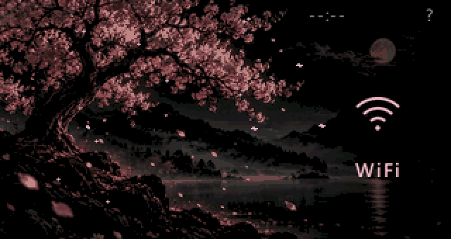
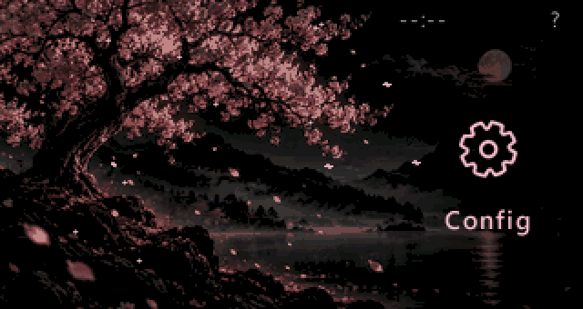
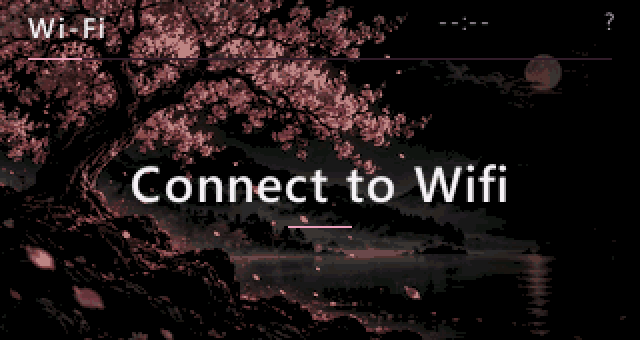
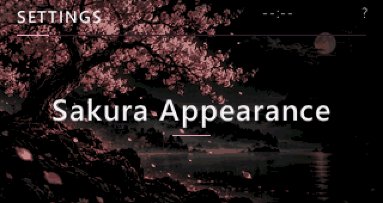
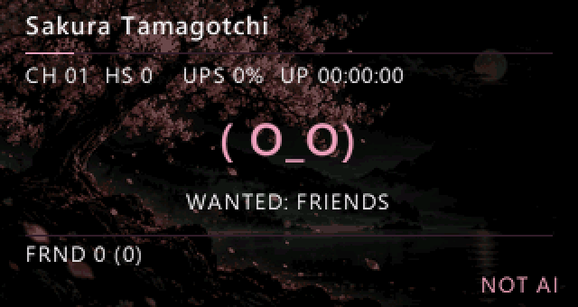

[Русский](README.md) | **English**


# SAKURA

**Custom firmware by BADMAAAN for the LILYGO T-Embed CC1101 Plus.**

A night-time cherry blossom scene, full-screen rotary-encoder navigation, and Wi-Fi, BLE, RF, RFID and IR tools in one pocket device.

**Under active development · Development.** There is no stable release yet. The current base is `0.3.1-back` with the keyboard/power hotfix and Sakura Tamagotchi styling; the internal build environment remains `flux-delta`.

[Interface](#interface-in-action) · [Features](#what-is-implemented) · [Getting started](#getting-started) · [Documentation](#documentation) · [Limitations](#current-state)

## Interface in action

Below are **host preview and test fixture frames from the current SAKURA renderer**, using synthetic demonstration data. They are not photographs of a LilyGO device or results of live network or radio operations. The banner above is an artistic presentation of the scene used in the firmware.



*Home: our cherry blossom scene and shared status display.*



*Full-screen navigation: one focused item and rotary-encoder control.*



*Wi-Fi section: the tools screen, without scanning or connecting.*



*Settings: appearance and system sections.*


*SSH Profiles: an empty profile list; no server connection was made.*



*Sakura Tamagotchi: styling of the existing module; the statuses in this frame are synthetic.*

## What is implemented

The capabilities below are implemented in the current source. Their verification level is recorded in the [feature map](docs/FEATURES.md) and [known issues](docs/KNOWN_ISSUES.md); the presence of code does not mean full hardware acceptance.

- **Interface.** A 320×170 scene, single-focus navigation in the main menus, SAKURA NIGHT, Sakura Dawn and Monochrome; settings for petals, transitions, brightness and Reduced Motion. Working graphs and results retain their specialised views.
- **Quick access.** Up to 24 Favorites using stable IDs, reordering and removal; five recent screens in RAM, history clearing and disabling. Opening a safe screen does not start transmission.
- **Profiles and QR.** Up to 12 SSH Profiles, explicit Connect, server-key verification, timeouts and cancellation; passwords stay in RAM. My QR stores names and text, supports viewing, editing, removal and Favorites, and accepts up to **154 UTF-8 bytes** without truncation.
- **Tools.** Inherited Wi-Fi, BLE, CC1101/RF, RFID, IR, Files and Scripts; availability depends on build flags and hardware. A menu item does not prove that an additional module is present.
- **Keyboard and power.** The shared keyboard, including numeric/hex input, keeps accepting input after a short physical Back press; on-screen BACK cancels, and DEL deletes. The existing power-hold gesture is preserved. Battery-reading validation, Dim, Display Off, Sleep and explicit Deep Sleep are available.
- **Sakura Tamagotchi.** New styling for the existing module, retaining its statuses and logic. A standalone game companion, shop and progression system are not implemented.

## Getting started

SAKURA is intended for **LILYGO T-Embed CC1101 Plus** owners willing to build and test Development firmware. Additional radio modules depend on wiring and configuration; universal compatibility is not claimed.

Build from the checkout root with a configured Python/PlatformIO environment:

```powershell
.\scripts\build.ps1 -Environment flux-delta -Python .\.venv\Scripts\python.exe
```

The `-Python` path must point to an existing interpreter with PlatformIO; change that argument if your installation uses another location. The wrapper builds without installing firmware on a device. Do not run bare `pio run` without `-e`: the default environment targets another board.

Read the [build instructions](docs/BUILDING.md), [installation and update procedure](docs/INSTALLATION.md), and [limitations](docs/KNOWN_ISSUES.md). Updates use a compatible **application-only** `.pio/build/flux-delta/firmware.bin` after verifying the device and partition layout, preserving NVS, LittleFS and SD. A full merged image is not interchangeable with application-only. No stable binary release is offered here.

## Documentation

- [Installation and safe updates](docs/INSTALLATION.md)
- [Controls and keyboard](docs/CONTROLS.md)
- [Building and running the host preview](docs/BUILDING.md)
- [Themes and Sakura Appearance](docs/THEMES.md)
- [Battery and sleep](docs/BATTERY_AND_SLEEP.md)
- [Known issues](docs/KNOWN_ISSUES.md)
- [Repository Wiki and guide](wiki/Home.md)
- [SSH Profiles](docs/SSH_PROFILES.md), [QR Codes](docs/QR_CODES.md), [Favorites and Recent](docs/QUICK_ACCESS.md)
- [Roadmap](docs/ROADMAP.md)
- [Publication checks](docs/PUBLICATION_CHECKS.md)

Documentation lives inside the repository. These links point to files, not an empty GitHub Wiki. The detailed linked guides are currently mainly in Russian; this README is fully translated.

## Current state

**Keyboard/power hotfix verification dated 2026-10-16:** the historical final run recorded **114 tests PASS**; the `flux-delta` build passed. These results, the version and verification boundaries are preserved in the [hotfix report](docs/KEYBOARD_TAMAGOTCHI_HOTFIX.md). Checks of this publication snapshot are recorded [separately](docs/PUBLICATION_CHECKS.md).

- **Back P0 remains open across all active tools.** Shared Wi-Fi connect/scan and Suite owned-client cleanup were tested with an inert backend. Other tools' direct scan paths, synchronous BLE GATT/HFP, Ninebot and the separate HID server need further work and hardware qualification. RapidConnection is explicitly unavailable.
- **A real SSH server has not been qualified.** Host tests and a displayed profile do not prove a successful session. The exceptional libssh socket-close path remains in the development backlog.
- **Hardware acceptance is incomplete.** The manual keyboard scenario after the hotfix awaits verification; battery readings after charging, sleep current, repeated sleep/wake cycles, absence of ST7789 flashes and long-term memory behaviour have not been separately qualified. Renderer cadence is not a measurement of LCD FPS or physical input latency.
- **QR has limits.** The maximum is 154 UTF-8 bytes, not 154 arbitrary characters; camera reading from the LilyGO screen is unconfirmed. BTC receive supports only mainnet Base58Check P2PKH/P2SH (`1…`, `3…`); `bc1…`, testnet and BIP21 input are unsupported. The default address is empty. The firmware does not create wallets, store seed/private keys or send payments.

The full list and boundaries of earlier hardware checks are in [known issues](docs/KNOWN_ISSUES.md). Use radio tools only with your own devices and in authorised environments.

## Plans

**Planned**, after verification of existing behaviour:

- Full hardware qualification of Back, keyboard, power and QR.
- SSH Macros and a unified local Web Companion.
- SD background replacement and a user-facing Backup/Restore workflow.
- Safe Update Manager and a standalone optional Tamagotchi companion.

These are development directions, not available features or promised dates. Detailed statuses are in the [roadmap](docs/ROADMAP.md).

## Authorship and licence

**BADMAAAN is the author of the SAKURA project**, its presentation and changes. The codebase evolved through **Bruce → FLUX → FLUX DELTA → SAKURA**; the independent brand does not imply that all inherited code was written from scratch.

The [historical FLUX README](docs/FLUX_README.md), [DELTA materials](docs/FLUX-DELTA.md) and [credits](docs/CREDITS.md) are preserved. The project is distributed under [GNU AGPL v3](LICENSE); details of AGPL-3.0-or-later, individual components and their licences are in [THIRD_PARTY.md](THIRD_PARTY.md). Copyright notices and individual file licences remain intact.

