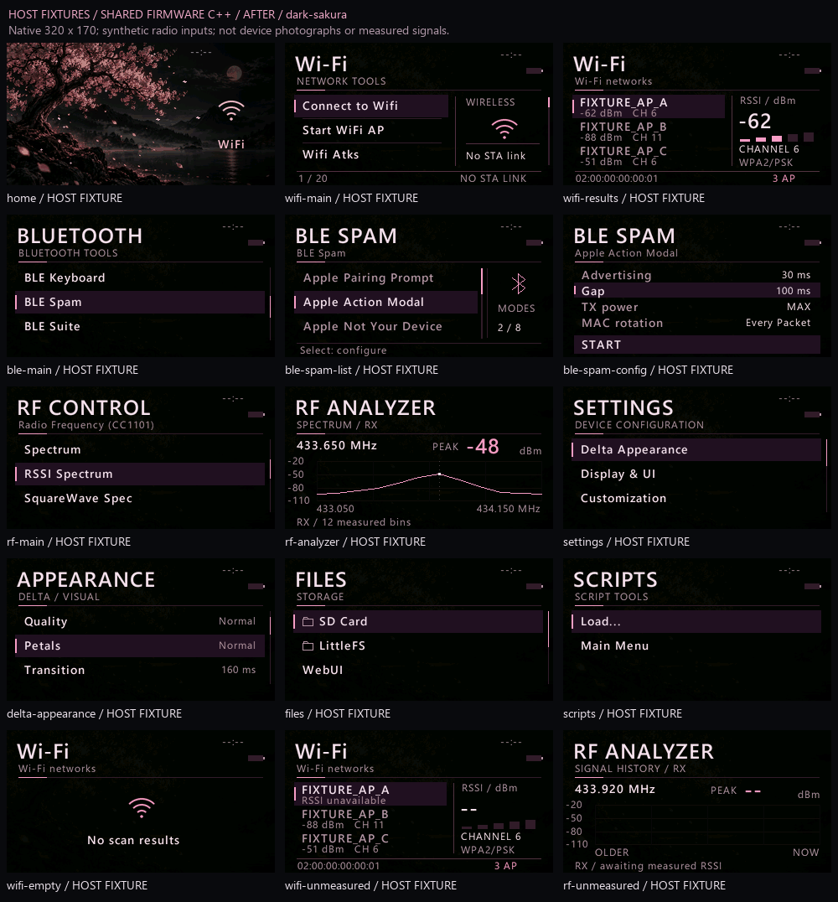
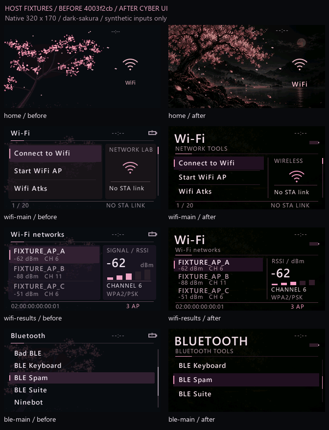
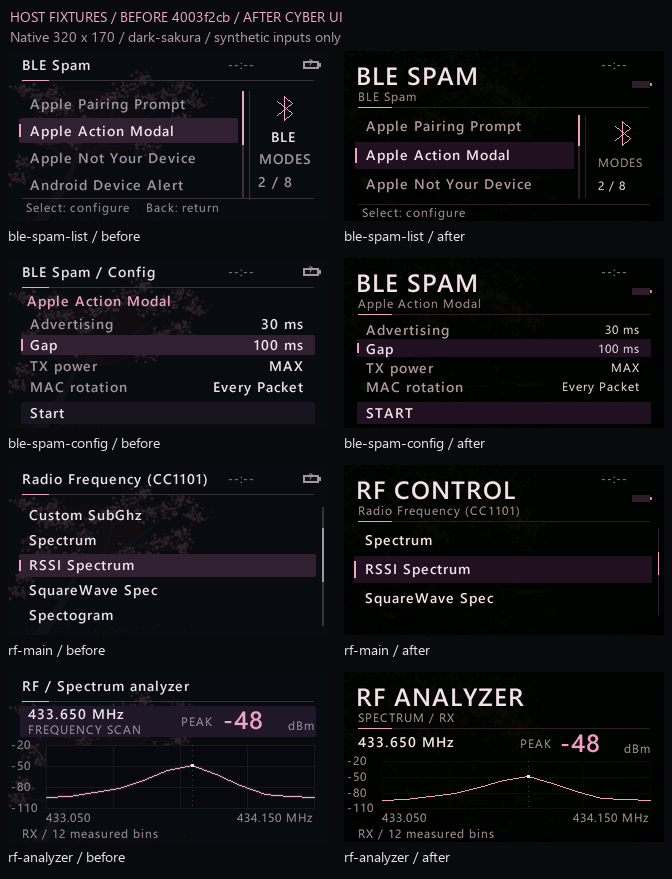
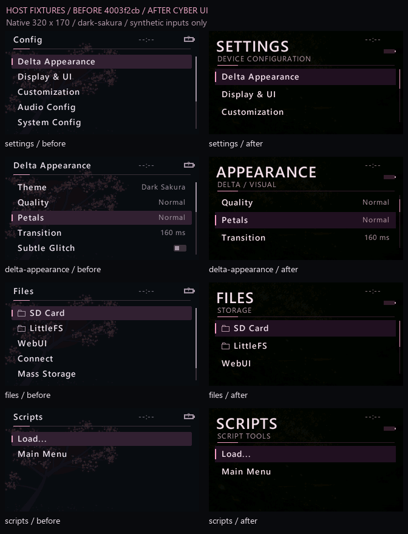
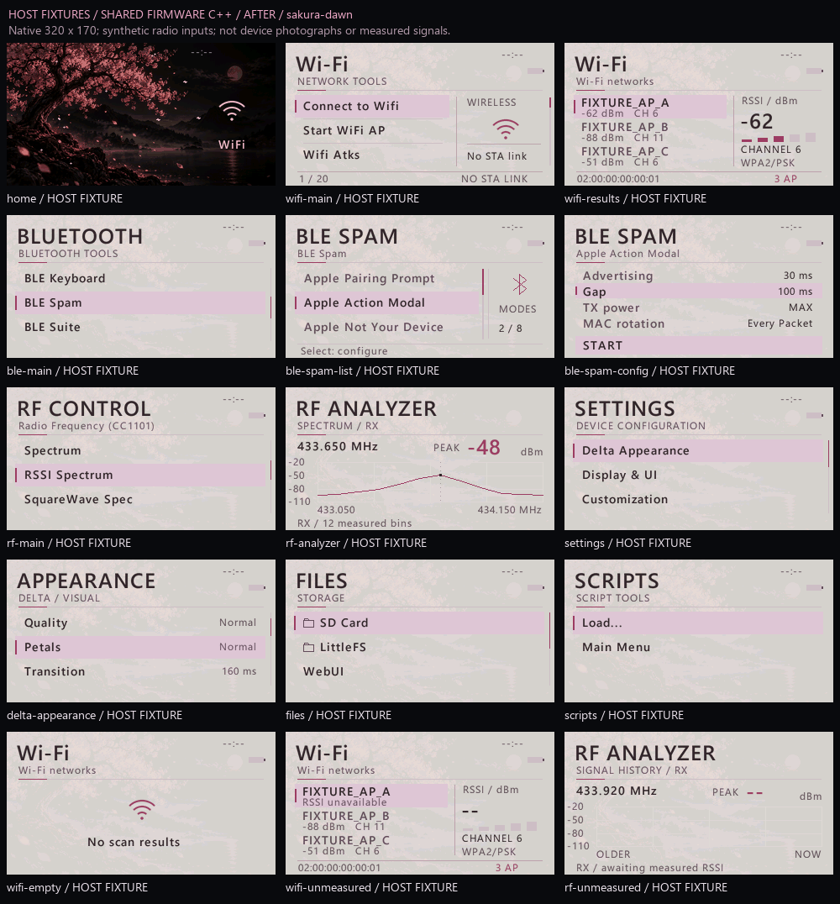
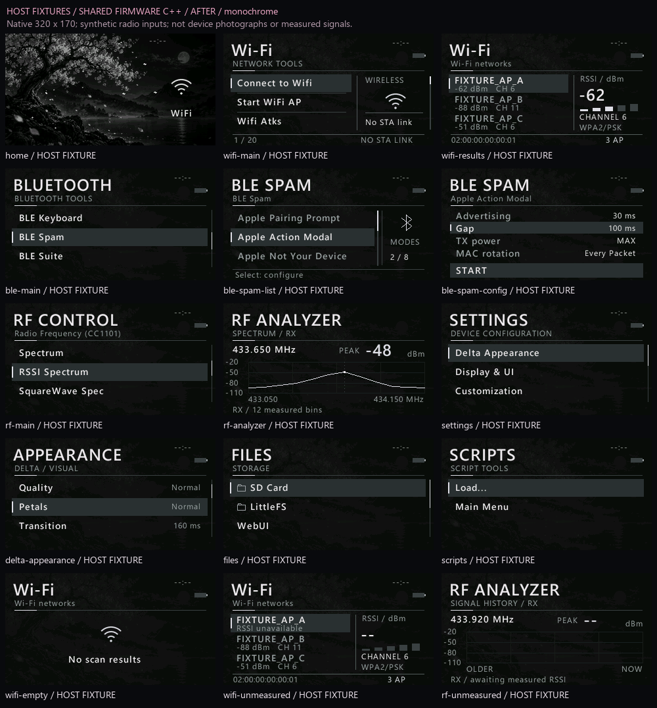

# FLUX DELTA: Cyber UI, native comparison

Все изображения здесь — **HOST FIXTURES**: кадры общего production C++-рендера размером **320×170**. Это не фотографии LilyGO, не найденные сети и не измеренные радиосигналы. Имена `FIXTURE_AP_*`, адреса с префиксом `02:`, RSSI и RF-отсчёты заданы только для проверки компоновки. Радио, сеть, файловые операции и обработчики действий при генерации не запускаются.



Сравнение использует сохранённую реализацию commit `4003f2cb` слева и текущие заголовки прошивки справа. Один файл `tools/delta_preview/cyber.cpp` передаёт обеим реализациям одинаковые данные. Полное дерево `include/delta` базовой версии, включая artwork и сглаженные шрифты, извлекается из Git в отдельный временный каталог. Предыдущие галереи сохранены отдельно.







Основные режимы используют крупные заголовки, нативный сглаженный текст и общее пространство экрана. В Wi-Fi остаются отдельная зона сигнала и реальные поля модели: RSSI, канал, security, BSSID. BLE Spam сохраняет читаемую выбранную строку, параметры и отдельное действие START. RF рисует переданные отсчёты и настоящий вычисленный максимум массива; состояние ожидания не создаёт сигналы. В этой галерее сами входные значения являются фикстурами.

Для Home зафиксирован один момент анимации — `4260 ms`, с одинаковыми настройками лепестков, неизвестным зарядом и временем `--:--`. Кадры показывают реальный рендер прошивки без увеличенного wallpaper. Сравнение Home не измеряет плавность движения.

Дополнительные сцены показывают пустые результаты Wi-Fi, неизвестный RSSI и RF без измерений. Скрипты представлены существующими действиями Load/Main Menu; вымышленные файлы или обнаруженные устройства не добавляются.





Каждый основной кадр сохранён в исходных 320×170 и увеличен в четыре раза методом ближайшего соседа для проверки пикселей. Это один рендер, а не отдельный интерфейс высокого разрешения. Полные сравнения всех двенадцати основных экранов доступны также в `HOSTFIXTURE_BEFORE_AFTER_<theme>.png` для каждой темы.

В `HOSTFIXTURE_manifest.json` записаны SHA256 всех использованных заголовков, генератора и изображений, точный базовый commit и время CPU хоста. Поле `sources_changed_during_capture` должно быть пустым для окончательной галереи. **CPU хоста не является FPS или задержкой LilyGO:** он не учитывает передачу на LCD, обработку ввода и работу остальных модулей. Аппаратные замеры и проверка энкодера выполняются отдельно.

Воспроизведение существующими локальными инструментами:

```powershell
& 'C:\Projects\FLUX\.venv\Scripts\python.exe' -X utf8 tools/delta_preview/cyber_preview.py
```
