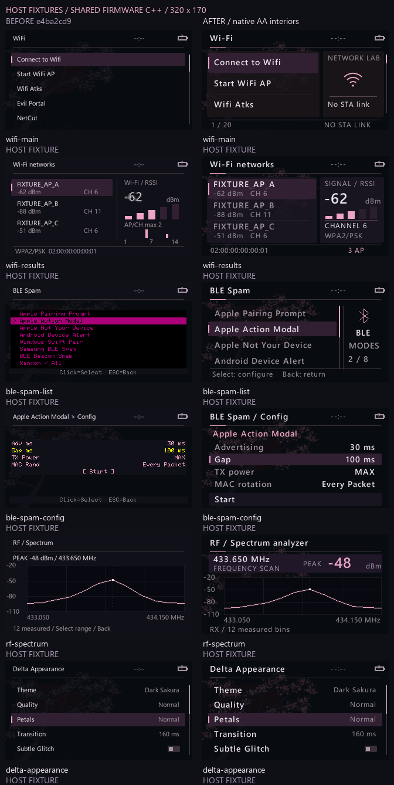
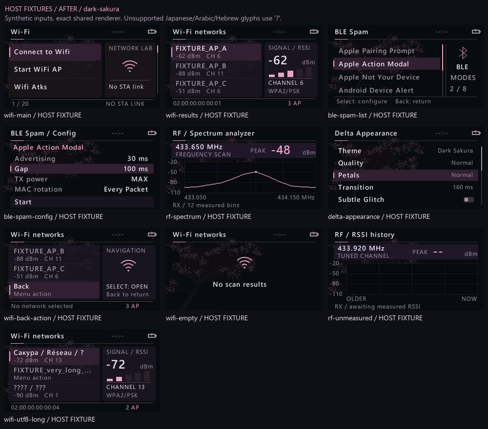
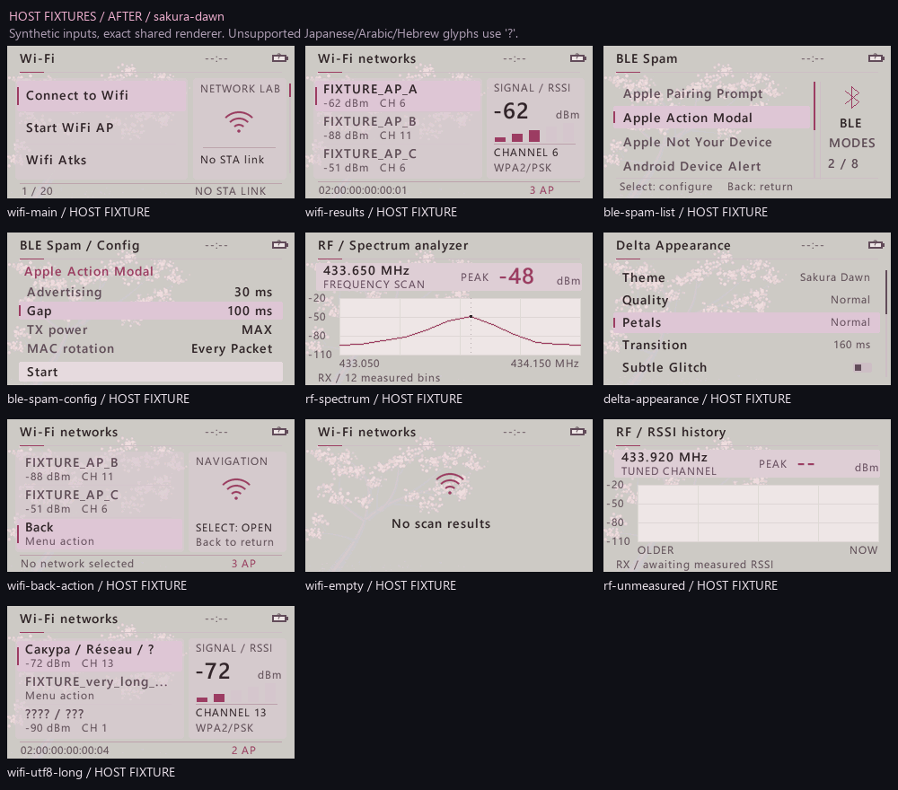
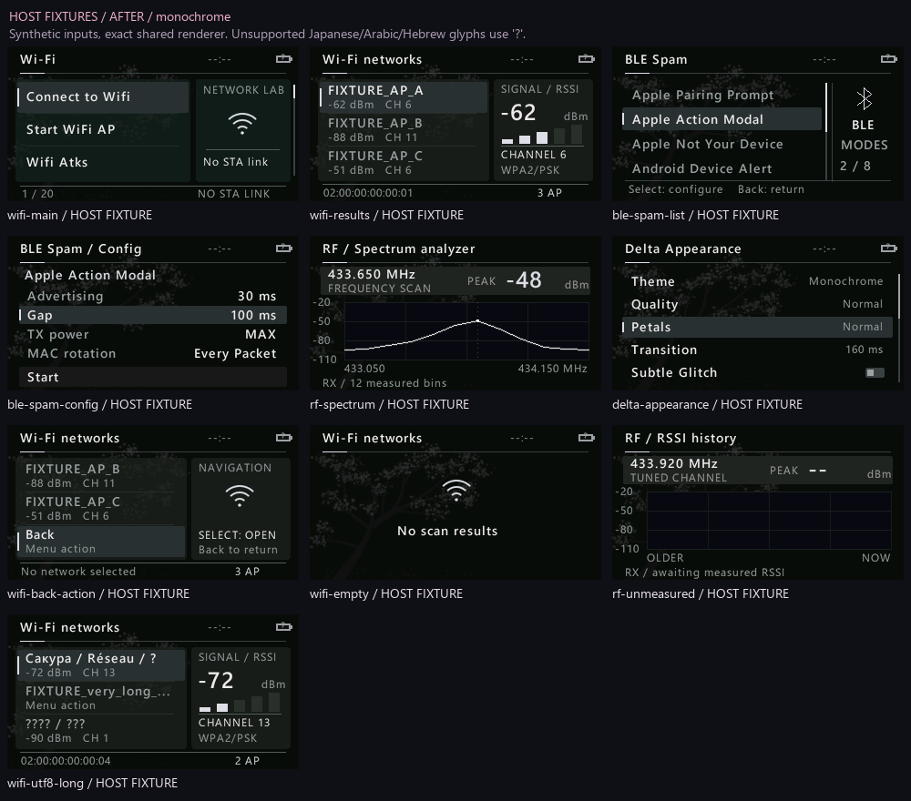

# DELTA: внутренние экраны, сравнение

Все изображения ниже — **HOST FIXTURES**, кадры общего C++-рендера при 320×170. Это не фотографии LilyGO и не результаты реального сканирования. Названия `FIXTURE_AP_*`, уровни RSSI, частотные отсчёты и адреса заданы только для проверки компоновки; обработчики радио не вызываются.



В сравнении показаны Wi-Fi main, Wi-Fi results, BLE Spam list, BLE Spam config, RF Spectrum и Settings → Delta Appearance. Левая колонка собирается из сохранённых заголовков commit `e4ba2cd9`, правая — из текущих production-заголовков. Входные значения обеих колонок задаёт один файл `tools/delta_preview/interior.cpp`.

Для BLE колонки «до» используются извлечённые без изменений тела старых painter-функций и блока отрисовки конфига из того же commit. Минимальный host-адаптер воспроизводит их примитивы и использует существующий `TFT_eSPI/Fonts/glcdfont.c`, включая непрозрачный чёрный sprite старого списка. Это проверяемая реконструкция старой отрисовки на хосте; снимком физического дисплея она не является. Старый BLE painter не поддерживал темы DELTA, поэтому его сравнение показано только для Dark Sakura.

Wi-Fi main получает собственную полноэкранную компоновку и боковую панель. Результаты используют реальные поля существующей модели: RSSI, канал, security и BSSID выбранной сети и число найденных AP. В этих изображениях сами значения являются фикстурами. RF график использует переданный массив отсчётов; пустой массив даёт состояние ожидания измерений.

Шрифты внутренних экранов растеризованы в нативном размере, с четырьмя битами покрытия и сглаживанием: основной 14 px, метаданные 12 px, крупные показания 25 px. Четырёхкратные PNG — увеличение ближайшим соседом для проверки исходных пикселей, а не альтернативный рендер высокого разрешения.







Дополнительно проверяются Back как действие без ложного RSSI, пустой Wi-Fi scan, RF без измерений, длинное имя сети, кириллица и Latin1. Японские, арабские и еврейские символы отсутствуют в атласе и заменяются одним `?` на Unicode codepoint; полноценная поддержка этих письменностей не заявляется.

В `HOSTFIXTURE_manifest.json` записаны SHA256 исходников и изображений, точный commit колонки «до», пропуски и замеры времени CPU хоста. Эти замеры не являются FPS или задержкой LilyGO: они исключают передачу на LCD и остальную прошивку.

Воспроизведение существующими инструментами:

```powershell
& 'C:\Projects\FLUX\.venv\Scripts\python.exe' tools/delta_preview/interior_preview.py
```

Фактические цвета, читаемость и управление на LilyGO подтверждаются отдельно после установки; host-изображения не заменяют аппаратную проверку.
