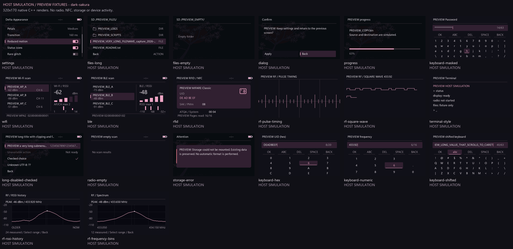
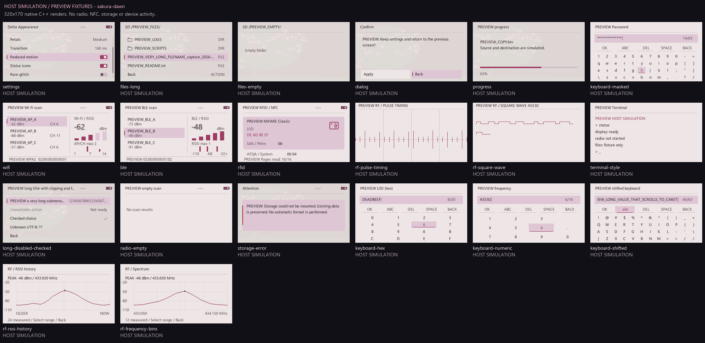
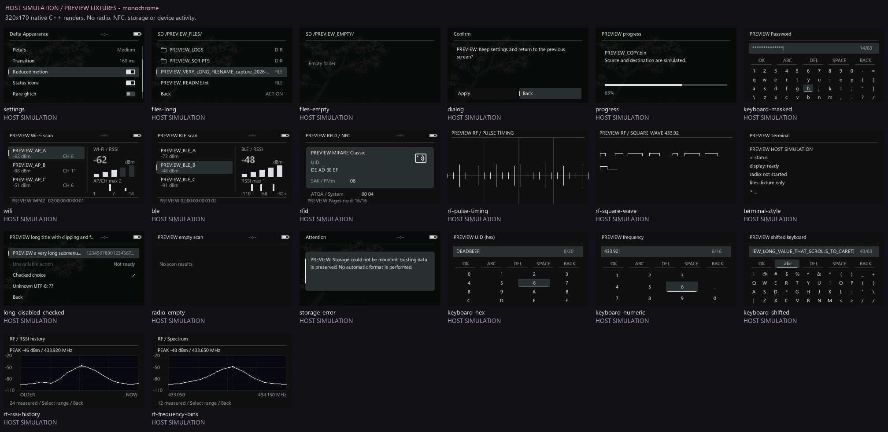

# FLUX DELTA: сравнение интерфейса и проверяемый предпросмотр

**Все изображения в `assets/delta/system-preview` — HOST SIMULATION.** Это локальный рендер C++ с явно заданными данными `PREVIEW_*`, а не фотографии LilyGO, результаты обнаружения устройств или измерения радиосигнала. Захват не запускает Wi-Fi, BLE, RF, RFID, файловые операции или команды терминала.

## До и после

Исходная точка сравнения — локальный commit `6ade36dd`, установленная и проверенная ранее DELTA. Фотографии старого интерфейса в этом наборе отсутствуют. Старый экран намеренно не реконструирован картинкой: без точного TFT-шрифта и настроек такая картинка могла бы вводить в заблуждение. Поведение до изменения проверяется по `git show 6ade36dd:src/core/display.cpp` и соответствующим исходникам инструментов.

| Область | До: фактический код | После: фактический код |
|---|---|---|
| Вложенные меню | `drawOptions`: окно шириной 80% экрана, широкое выделение `priColor`, `>` перед строкой, текст через TFT | `deltaUiMenu` → общие `row`, `header`, `textClip`: пять видимых строк, плавное положение фокуса, тихая сливовая подложка, узкий акцент и отдельные значения |
| Delta Appearance | Те же обычные строки меню | Общая система тем, отдельные переключатели, видимая отметка выбранного значения, обрезка длинного текста |
| Файлы | `listFiles`: прежняя TFT-компоновка и встроенные символы | Заголовок накопителя/пути, папки, тип строки, фокус, прокрутка, пустая папка |
| Подтверждения | `displayMessage`: прежние кнопки и TFT-текст | Общие палитра, заголовок, перенос сообщения, сливовые кнопки с узким акцентом |
| Ошибки и сообщения | `displayRedStripe`: цветная полоса старого интерфейса | Общая карточка сообщения, семантический акцент, читаемый перенос текста |
| Прогресс | Прежняя полоса и подпись | Общий компактный прогресс с реальным процентом; масштабирование и границы проверяются отдельно |
| Клавиатура | Прежние поля/кнопки/ячейки | Производственный `drawDeltaKeyboard`: 12 колонок, маска пароля, каретка, счётчик, доступные действия; HEX и NUM используют исходные раскладки |
| Wi-Fi/BLE | Название и метаданные склеены в длинную строку | `radioResults`: строки результатов, выбранное RSSI, индикатор уровня, распределение текущего снимка, адрес/защита отдельной строкой |
| RFID | `dump_card_details`: последовательный вывод строк | `rfidCard`: карточка с типом, UID, SAK/PMm, ATQA/System и прочитанными страницами |
| RF | Существующий график с прежними цветами | Те же отсчёты и геометрия измерения, тонкая сетка и согласованная палитра; waterfall использует цвет по реальному RSSI |
| Терминал и прочие прямые TFT-экраны | Прямой TFT-вывод | Общий заголовок/подложка и преобразование основных цветов через `deltaUiMapColor`; собственный текстовый поток инструмента сохраняется |

Графики на устройстве используют только полученные измерения. Столбцы Wi-Fi показывают число точек из предоставленного снимка по каналам; BLE — распределение RSSI в том же снимке. Они не являются временной историей и не обещают полный эфир за пределами существующего ограничения списка результатов.

## Контактные листы

Каждая ячейка сохраняет исходные 320×170 пикселей. Подпись **HOST SIMULATION** вынесена за кадр, чтобы не подменять настоящий результат рендера. Для каждого кадра также сохранена версия 1280×680 с увеличением ближайшего соседа.







## Точность каждого типа кадра

| Кадры `PREVIEW_*` | Как получены |
|---|---|
| settings, files-long, files-empty, long-disabled-checked | Вызовы тех же общих C++-виджетов `widgets.h`; данные и положение выбора заданы для проверки. Статический кадр не доказывает качество анимации или работу накопителя |
| dialog, storage-error | Блоки отрисовки `displayMessage` и `displayRedStripe` извлекаются из текущего `display.cpp` дословно при запуске. Обработчики ввода не исполняются |
| progress | Прямой вызов общего `progress`, который используется `progressHandler`; значение 63% задано в предпросмотре |
| keyboard-masked, keyboard-hex, keyboard-numeric, keyboard-shifted | Дословно извлечённые производственные `drawDeltaKeyboard` и исходные QWERTY/HEX/NUM-таблицы. Минимальный адаптер заменяет Arduino String на std::string; ввод не производится |
| wifi, ble, radio-empty | Прямой вызов производственного `radioResults`; адреса, имена и RSSI являются явно вымышленными `PREVIEW`-фикстурами |
| rfid | Прямой вызов `rfidCard` с `PREVIEW MIFARE Classic` и тестовым UID `DE AD BE EF`; карта не считывалась |
| rf-pulse-timing, rf-square-wave | Вспомогательные иллюстрации геометрии/палитры импульсов с фиксированными тестовыми отсчётами, не критерии приёмки. Заголовок PULSE TIMING намеренно не называет импульсы частотным спектром. Полный RF-обработчик и драйвер TFT на компьютере не исполняются |
| rf-rssi-history, rf-frequency-bins | Прямой вызов общего производственного `rfGraph` из `include/delta/rf_graph.h` с тестовыми RSSI и частотами. Его же вызывает физический `rf_CC1101_rssi`. Временные отсчёты и частотные корзины различаются подписями оси; шкала dBm и пик берутся из переданных данных. Только эти два RF-кадра пригодны для ревью общего RSSI-рендера; acquisition и аппаратный RF здесь не проверяются |
| terminal-style | Иллюстрация общей палитры и заголовка с безопасными тестовыми строками. TFT-шрифт конкретного терминала и реальные команды здесь не воспроизводятся |

## Воспроизведение и измерения

В корне DELTA запустить существующим Python с Pillow:

```powershell
& 'C:\Projects\FLUX\.venv\Scripts\python.exe' tools/delta_preview/system_preview.py
```

Скрипт использует уже установленный Zig из `.tools/zig`, компилирует локальную библиотеку и создаёт 60 исходных PNG, 60 версий 4×, три контактных листа и `PREVIEW_manifest.json`. Сервер и браузер не требуются. Исходный FLUX не изменяется.

В манифесте сохранены SHA-256 использованных исходников и PNG, а также среднее CPU-время 500 повторов каждого кадра. Это измерение Windows C++-рендера: оно исключает LCD/SPI, работу прошивки, кодирование PNG и адаптацию радиоданных. **Эти числа нельзя выдавать за FPS, задержки или потребление LilyGO.**

Проверка настоящего экрана, переходов, кнопок, батареи и производительности выполняется отдельно после сборки и безопасной установки. Данный набор предназначен для визуального ревью компоновки, контраста, обрезки, тем, пустых состояний и форм ввода.
